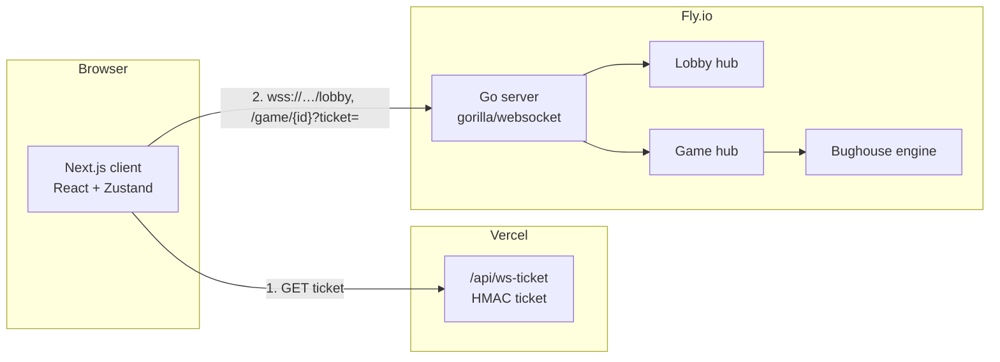

# Bughouse Chess

Real-time, four-player **bughouse chess** in the browser. A Go WebSocket server runs the game, and the client is built with Next.js.

**Live:** [bughouse-app.vercel.app](https://bughouse-app.vercel.app)

Bughouse is a team chess variant. Two teams of two play on two boards at once. When you capture a piece, it goes to your partner, who can **drop** it onto their own board in place of making a move. The first checkmate on either board decides the match.

---

## Features

- **Lobbies.** Create or join a 4-player lobby, choose a time control, pick seats or shuffle teams at random, and ready up with a synced countdown.
- **Two live boards.** Your board is interactive, and your partner's board is shown read-only beside it. All four piece reserves and clocks update in real time.
- **Piece drops and premoves.** Drop pieces from your reserve. You can queue a move or drop while it's your opponent's turn, and a queued drop waits until your partner has sent you that piece.
- **Optimistic UI.** Your moves show on the board immediately, and the server's authoritative state replaces them when it arrives.
- **Rematches with a running score.** When all four players vote for a rematch, colours swap and per-player scores carry over between games.
- **Team chat** with quick messages ("Send piece!", "Hold on!").
- **Quick Play vs bots.** Start a game straight away against three bots that play random legal moves.

## Architecture



- **The server is the authority.** Every move and drop is checked by a custom Go chess engine (`server/internal/engine`), so the client never decides whether a move is legal. Clients render server snapshots: each board's FEN, the four piece banks, the four clocks and the scores.
- **Custom engine.** The engine does its own move generation, legality checks and FEN parsing. On top of standard chess it handles the bughouse rules: drops, no pawn drops on the first or last rank, captures routed to the partner's bank, and a captured promoted piece going back as a pawn. Stalemate counts as a loss.
- **Four independent clocks.** A server-side `ClockManager` runs one active clock per board and adds increments. Clients interpolate the clocks locally between server updates.
- **Connection tickets.** The Next.js API route signs a timestamp with a secret shared with the Go server (`WS_SECRET`). The server only accepts WebSocket upgrades that carry a ticket less than 60 seconds old.
- **State is in memory.** Lobbies and games live in process memory, which keeps the server simple and fast at the cost of durability across restarts.

### WebSocket protocol

Every message uses the envelope `{ "type": string, "data": any }`.

| Endpoint | Client → server | Server → client |
| --- | --- | --- |
| `/lobby` | `lobby:list`, `lobby:create`, `lobby:join`, `lobby:leave`, `lobby:ready`, `lobby:start` | `lobby:list`, `lobby:created`, `lobby:updated`, `lobby:error`, `game:starting` |
| `/game/{id}` | `game:move`, `game:drop`, `game:resign`, `game:message`, `game:rematch` | `game:state`, `game:update`, `game:ended`, `game:message`, `game:rematch_votes`, `game:starting`, `error` |

## Tech stack

| Layer | Technology |
| --- | --- |
| Web client | Next.js 16 (App Router), React 19, TypeScript, Tailwind CSS 4, Zustand |
| Chess UI | react-chessboard, chess.js (client-side move hints only) |
| Server | Go 1.23, gorilla/websocket |
| Hosting | Vercel (web), Fly.io in Toronto (server, Docker) |
| CI | GitHub Actions: gofmt, vet, build and tests for Go; typecheck, build and lint for the web app |

## Repository layout

```text
.
├── server/                  Go WebSocket server
│   ├── cmd/server/          entry point: HTTP mux, ticket auth, CORS
│   └── internal/
│       ├── engine/          bughouse chess engine (boards, move gen, FEN, banks)
│       ├── game/            sessions, clocks, rematches, bots
│       ├── lobby/           lobby model and manager
│       └── ws/              lobby and game WebSocket hubs
├── web/                     Next.js client
│   ├── app/                 routes: home, lobbies, game, how-to-play, ws-ticket API
│   ├── components/          boards, clocks, piece banks, chat, lobby UI
│   ├── lib/                 WebSocket hooks, identity, shared types
│   └── store/               Zustand stores for lobby and game state
└── docs/                    design system and assets
```

## Running locally

**Prerequisites:** Go 1.23+ and Node.js 22+.

```bash
# 1. Server (http://localhost:3001)
cd server
go run ./cmd/server

# 2. Web client (http://localhost:3000), in a second terminal
cd web
npm install
npm run dev
```

Optional `web/.env.local`:

```bash
NEXT_PUBLIC_SERVER_URL=http://localhost:3001   # Go server URL (default shown)
WS_SECRET=<shared secret>                      # must match the server; leave unset to skip ticket auth in dev
```

To try a game on your own, click **Quick Play vs Bots**. To test a real lobby, open four browser profiles or incognito windows.

## Testing

```bash
cd server && go test ./...
cd web && npx tsc --noEmit && npm run lint
```

## Deployment

- **Server:** run `fly deploy` from `server/` (see `fly.toml` and `Dockerfile`), and set `WS_SECRET` as a Fly secret.
- **Web:** pushes to `main` deploy to Vercel. Set `NEXT_PUBLIC_SERVER_URL` and `WS_SECRET` in the Vercel project.

## How bughouse works

1. Two teams of two. Team 1 is White on board 1 and Black on board 2. Team 2 is Black on board 1 and White on board 2.
2. When you capture a piece, it goes into your partner's reserve.
3. On your turn you can drop a piece from your reserve onto any empty square instead of moving. Pawns can't be dropped on the first or last rank.
4. A captured promoted piece goes back to the reserve as a pawn.
5. The match ends as soon as either board ends by checkmate, stalemate, timeout or resignation.

There's a longer guide on the in-app **How to Play** page.

## Roadmap

Planned work, including a test suite, reconnection, invite links, accessibility and analytics, is tracked in the issue tracker.
